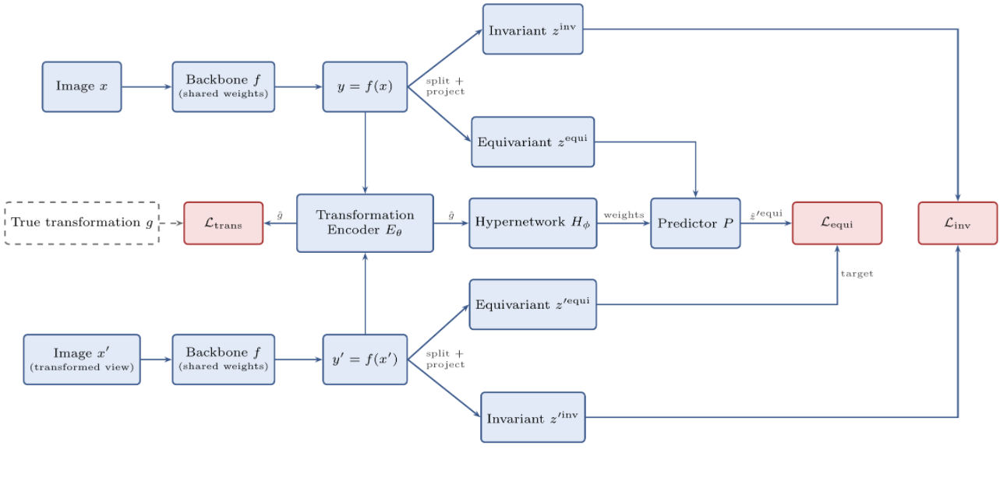
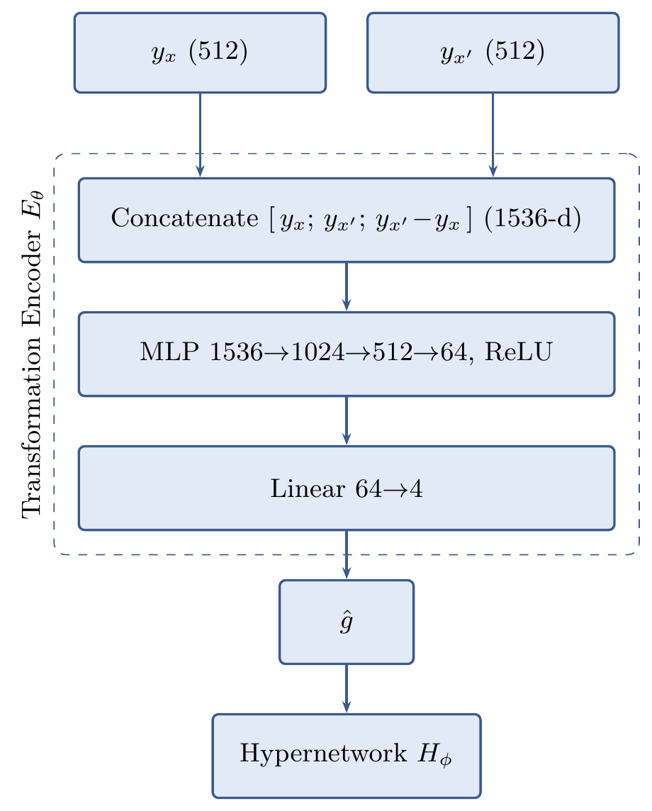
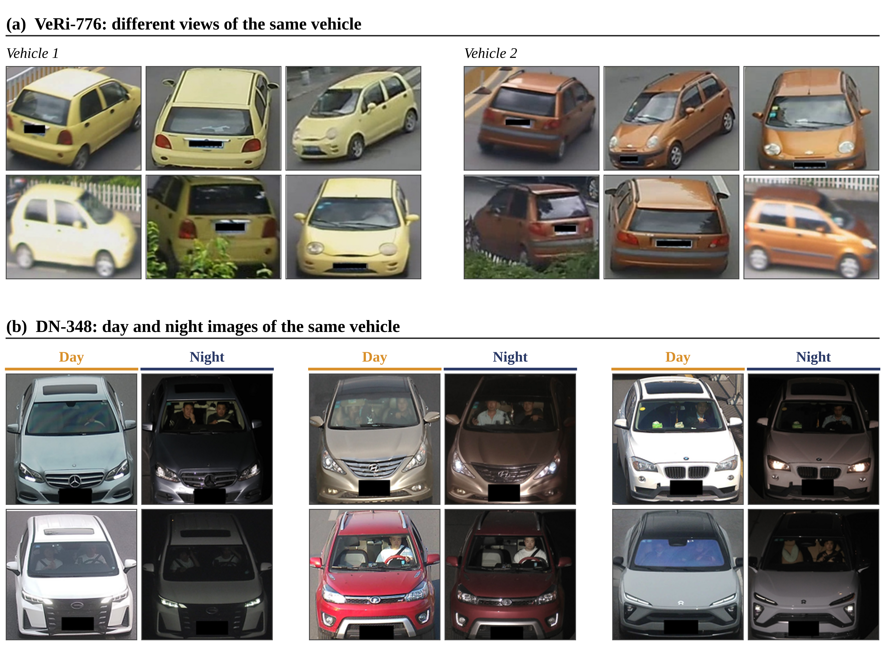

# Equivariant–Invariant Feature Learning for Visual Perception

<p align="center">
  
</p>

**Author:** R Prerana, KLE Technological University

## Problem Statement

Develop a representation learning framework that jointly learns invariant and equivariant feature representations from image pairs, preserving object identity while retaining transformation-specific information, without requiring the transformation label during inference.

## Objectives

- To learn invariant and equivariant feature representations jointly from pairs of images.
- To preserve object identity in the invariant representation while retaining transformation-specific information in the equivariant representation.
- To estimate the transformation between two images directly from their features, so that no transformation label is needed at inference.

## Proposed Approach

A shared backbone encodes both images. Each feature vector is split into an invariant and an equivariant component, and these are projected by separate heads. The invariant components of the two images are encouraged to agree. A predictor maps the equivariant component of the first image to that of the second, and its parameters are generated by a hypernetwork that is conditioned on the transformation.

**Contribution.** A **Transformation Encoder** estimates this transformation from the backbone features of the two images and their difference. The estimate replaces the externally supplied transformation as the input to the hypernetwork. The ground-truth transformation is used only during training, to supervise the encoder, together with an inverse-consistency loss on the reversed image pair. At inference, only the image pair is required.

<p align="center">
  
</p>

**Transformation Encoder.** The input is the concatenation of the two backbone features and their difference, a 1536-dimensional vector. It passes through an MLP with layers 1536, 1024, 512 and 64 with ReLU, then a linear layer of size 4, which gives the estimated transformation ĝ. The encoder input is detached, so the encoder does not update the backbone.

For continuous transformations the output is L2-normalised to a unit quaternion and trained with a geodesic loss. For categorical transformations the output gives class probabilities and is trained with cross-entropy.

**Training objective**

```
L = λ_inv·L_inv + λ_equi·L_equi + λ_trans·L_trans + λ_ic·L_ic + λ_std·L_std + λ_cov·L_cov
```

| Term | Purpose |
|---|---|
| `L_inv` | Agreement of the invariant representations of the two images |
| `L_equi` | Match between the predicted and the actual equivariant representation |
| `L_trans` | Supervision of the Transformation Encoder with the ground-truth transformation during training |
| `L_ic` | Inverse consistency between the estimates for the forward and the reversed pair |
| `L_std`, `L_cov` | Variance and covariance regularisation against representational collapse |

## Datasets

The framework is evaluated on three datasets, each with a different kind of transformation between the two images of a pair.

<p align="center">
  
</p>

- **3DIEBench** – rendered 3D objects; the transformation is the relative object rotation, known exactly for every pair.
- **VeRi-776** – real-world vehicle images from multiple cameras; the transformation is the relative viewpoint, derived from eight orientation bins.
- **DN-348** – vehicle images captured by day and by night; the transformation is a four-class day/night transition: day-to-day, night-to-night, day-to-night or night-to-day.

The datasets are **not** included in this repository. Please obtain them from the official sources below and follow their terms of use.

| Dataset | Official source |
|---|---|
| 3DIEBench | https://github.com/facebookresearch/SIE |
| VeRi-776 | https://vehiclereid.github.io/VeRi/ |
| DN-348 | https://github.com/chenjingong/DN-ReID |

## Technologies and Tools

- Python, PyTorch, torchvision, ResNet-18 backbone
- NumPy, SciPy, scikit-learn, Pillow, matplotlib
- Conda / pip for environment management
- Git and GitHub for version control and release of the code and weights

## Repository Structure

```
.
├── 3DIEBench/             # Rotation setting
│   ├── main.py            # Proposed training script (quaternion encoder)
│   ├── eval_*.py          # Evaluation scripts
│   ├── data/              # Rendering and sampling utilities
│   └── src/               # Model components and quaternion utilities
├── VeRi-776/              # Viewpoint setting
│   ├── main.py            # Proposed training script
│   ├── train_sie_baseline.py   # True-label reference training
│   ├── eval_*.py          # Evaluation scripts
│   ├── analysis/          # Dataset inspection utilities
│   └── src/               # Model components and dataset loader
├── DN-348/                # Illumination setting
│   ├── main.py            # True-label reference training
│   ├── scripts/           # Proposed training and evaluation scripts
│   ├── eval_*.py          # Evaluation scripts
│   └── src/               # Models, losses, transformation utilities
├── configs/               # Hyperparameters of the final runs
├── docs/                  # Figures and file map
├── environment.yml
├── requirements.txt
├── LICENSE                # GPL-3.0
└── NOTICE                 # Attribution and copyright notices
```

The hyperparameters of every final run are in `configs/`.

## Installation

```bash
# Conda
conda env create -f environment.yml
conda activate sie_new

# or pip
pip install -r requirements.txt
```

## Pretrained Weights

The pretrained checkpoints of the proposed framework are available on the **[Releases](../../releases)** page of this repository. Download them and place them in a `weights/` folder in the repository root.

| File | Contents |
|---|---|
| `3die_epoch500.pth` | Proposed model, 3DIEBench |
| `veri776_epoch700.pth` | Proposed model, VeRi-776 |
| `dn348_step9000.pth` | Proposed model, DN-348 |

## Training

Training length and the remaining hyperparameters follow the files in `configs/`; pass them with the corresponding command-line options.

**3DIEBench**
```bash
python 3DIEBench/main.py \
  --experience SIE_STL \
  --dataset-root ./data/3DIEBench \
  --images-file ./data/3DIEBench/train_images.npy \
  --labels-file ./data/3DIEBench/train_labels.npy \
  --exp-dir ./checkpoints/3die_proposed \
  --batch-size 64 --base-lr 0.001
```

**VeRi-776**
```bash
# True-label reference
python VeRi-776/train_sie_baseline.py --experience SIE \
  --dataset-root ./data/VeRi --exp-dir ./checkpoints/veri_baseline \
  --batch-size 8 --base-lr 0.001

# Proposed
python VeRi-776/main.py --experience SIEQuatEncoder \
  --dataset-root ./data/VeRi --exp-dir ./checkpoints/veri_proposed \
  --batch-size 64 --base-lr 0.001 \
  --trans-weight 60.0 --std-coeff 35.0 --sim-coeff 5.0
```

**DN-348**
```bash
# True-label reference
python DN-348/main.py --experience SIECategoricalOracle \
  --dataset-root ./data/dn348 --exp-dir ./checkpoints/dn348_oracle \
  --batch-size 64 --base-lr 0.001

# Proposed
python DN-348/scripts/train_sie_identity_supcon_10k.py \
  --dataset-root ./data/dn348 --weights-file ./weights/veri776_epoch700.pth \
  --exp-dir ./checkpoints/dn348_identity_supcon --target-steps 10000
```

## Evaluation

At test time the proposed model receives only the image pair. Ground-truth labels are used only to score the estimated transformation.

**3DIEBench**
```bash
python 3DIEBench/eval_classification.py --dataset-root ./data/3DIEBench --weights-file ./weights/3die_epoch500.pth --inv-part --batch-size 128
python 3DIEBench/eval_angle_prediction.py --dataset-root ./data/3DIEBench --weights-file ./weights/3die_epoch500.pth --deep-end --equi-dims 256
python 3DIEBench/eval_feature_metrics.py --dataset-root ./data/3DIEBench --weights-file ./weights/3die_epoch500.pth
python 3DIEBench/eval_transformation_representation.py --dataset-root ./data/3DIEBench --weights-file ./weights/3die_epoch500.pth
```

**VeRi-776**
```bash
python VeRi-776/eval_classification.py --dataset-root ./data/VeRi --weights-file ./weights/veri776_epoch700.pth --num-classes 575 --inv-part
python VeRi-776/eval_angle_prediction.py --dataset-root ./data/VeRi --weights-file ./weights/veri776_epoch700.pth --num-classes 575 --deep-end --equi-dims 512
python VeRi-776/eval_predictor_metrics.py --dataset-root ./data/VeRi --weights-file ./weights/veri776_epoch700.pth
```

**DN-348**
```bash
python DN-348/scripts/eval_invariant_classification.py --checkpoint ./weights/dn348_step9000.pth --dataset-root ./data/dn348 --batch-size 64 --lr 0.01
python DN-348/scripts/evaluate_transformation_encoder.py --checkpoint ./weights/dn348_step9000.pth --dataset-root ./data/dn348
python DN-348/eval_predictor_metrics_dn348.py --checkpoint ./weights/dn348_step9000.pth --dataset-root ./data/dn348 --pairs-file ./data/splits/val_pairs.txt
python DN-348/scripts/eval_predictor_metrics_oracle.py --checkpoint ./weights/dn348_oracle.pth --dataset-root ./data/dn348 --pairs-file ./data/splits/val_pairs.txt
```

## Results

*True-label* denotes the same model with the ground-truth transformation supplied to the hypernetwork. *Proposed* estimates the transformation from the image pair.

**Transformation estimation** (estimate vs. ground-truth target)

| Dataset | Cosine similarity ↑ | L2 distance ↓ |
|---|---|---|
| 3DIEBench | 0.804 | 0.517 |
| VeRi-776 | 0.850 | 0.409 |
| DN-348 | 0.902 | 0.203 |

**Comparison with the true-label model**

| Dataset | Evaluation | True-label | Proposed |
|---|---|---|---|
| 3DIEBench | Top-1 classification (%) | 82.94 | 78.9 |
| | Rotation prediction (R²) | 0.73 | 0.487 |
| | Predictor cosine / L2 | 0.869 / 0.337 | 0.778 / 0.488 |
| VeRi-776 | Top-1 classification (%) | 64.5 | 70.1 |
| | Rotation prediction (R²) | 0.40 | 0.833 |
| | Predictor cosine / L2 | 0.85 / 0.33 | 0.92 / 0.30 |
| DN-348 | Top-1 classification (%) | 14.18 | 87.63 |
| | Transformation prediction | 0.234 | 0.927 |
| | Predictor cosine / L2 | 0.097 / 1.340 | 0.9417 / 0.2327 |

In the true-label model the transformation is supplied as an input, whereas in the proposed model it is estimated from the image pair.

## Current Progress and Future Work

The proposed framework is implemented and has been trained and evaluated on all three datasets. The code, configurations and pretrained weights are available in this repository, and a manuscript describing the work is in preparation.

The framework can be extended to other scenarios, for example:
- Other kinds of transformation between images, such as changes in scale, camera pose or weather.
- Other recognition tasks in which the same object is observed under different conditions, such as person re-identification.

## Licence

This project is released under the GNU General Public License v3.0. See the `LICENSE` file for the full text. Parts of the code are based on open-source software released under the same licence; their copyright notices are kept in the source files and listed in `NOTICE`. The datasets have their own licences and terms of use.

## Contact

R Prerana, rprerana777@gmail.com — KLE Technological University
